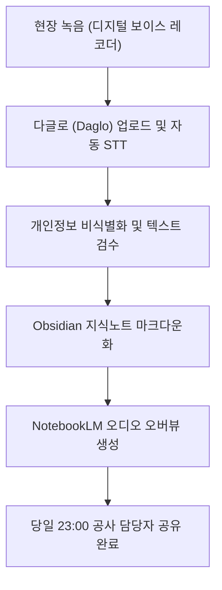

# AI 도구 활용 파이프라인 및 데이터 납품 가이드

## 1. 개요
- 과업 전 과정에서 AI 도구를 선도적으로 도입하여 데이터 전사 속도 향상, 정성 데이터 인사이트 구조화, 멀티미디어 산출물(AI 오디오 팟캐스트) 당일 납품 체계를 확립함.
- 공공기관 보안 규정에 의거, 개인정보(이름, 연락처 등)는 전사 및 분석 단계 전 비식별화(마스킹) 처리를 필수로 수행함.

---

## 2. 도입 도구 및 역할 정의

| 도구명 | 유형 | 주 사용 목적 | 보안 및 관리 방침 |
| :---: | :---: | :--- | :--- |
| **Obsidian** | 지식 관리 / 협업 | 프로젝트 과업 지식노트 체계 구축, 산출물 및 일정 동기화 | Vault 내 암호화 및 비식별화 마크다운 저장 |
| **Daglo (다글로)** | AI STT / 전사 | 현장 녹음 음성 파일의 자동 텍스트 변환 및 1차 화자 분리 | 음성 파일 업로드 시 개인정보 발화 부분 사전 확인 |
| **NotebookLM** | 생성형 AI (오디오) | 전사 마크다운 소스 기반 분석 및 심층 오디오 팟캐스트 음원 추출 | 세션별 핵심 쟁점 중심 소스 주입, 당일 공유 |
| **Claude / Gemini** | LLM / 데이터 분석 | 그룹별 질적 응답 텍스트 코딩, 키워드 추출, 교차 비교 분석 | 프롬프트 내 민감정보 배제, 정형화된 보고서 포맷 생성 |

---

## 3. FGI 당일 AI 처리 프로세스 (D-day 워크플로우)

### 가. 단계별 세부 절차
1. **음성 녹음 및 수령 (16:30 ~ 18:00)**:
   - 스튜디오 녹음 원본(WAV/MP3) 수령 및 세션별 파일 분리
2. **AI STT 변환 (18:00 ~ 19:30)**:
   - 다글로(Daglo) 배치 업로드, 음성 인식 및 화자 분리 진행
   - 주요 관광 용어 및 대구석 고유 명칭(가볼래-터, 배지랜드 등) 인식 오차 보정
3. **비식별화 및 요약 마크다운 작성 (19:30 ~ 21:00)**:
   - 참석자 이름 `[참가자A/30대/여]` 형태로 마스킹 변환
   - `[[세션별 회의록]]` 규격으로 옵시디언 볼트에 저장
4. **AI 오디오 팟캐스트 생성 (21:00 ~ 22:30)**:
   - 정리된 텍스트 노트를 NotebookLM 소스로 등록
   - 오디오 오버뷰(Audio Overview) 기능으로 핵심 쟁점 대담형 팟캐스트 음원 생성
5. **공유 및 납품 (22:30 ~ 23:00)**:
   - 옵시디언 싱크 및 지정 채널을 통해 공사 담당자에게 전사본, 요약본, 음원 링크 공유 완료
